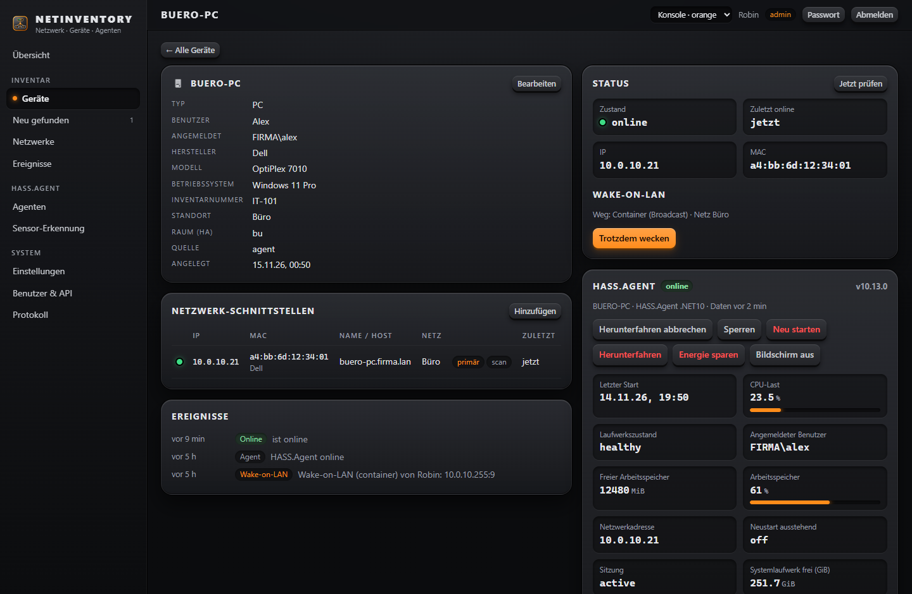

# NetInventory

Brings the devices of a [NetInventory](https://github.com/SysriX/netinventory_unraid) container – a network / IT device inventory with network scans, OPNsense ARP/DHCP, Wake-on-LAN and HASS.Agent – into Home Assistant. Every device of the inventory becomes a Home Assistant device with its online state, IP/MAC, user, the HASS.Agent sensors and buttons for Wake-on-LAN and the HASS.Agent commands (shutdown, restart, sleep, lock …).


*Device page in the NetInventory web UI (UI in German)*

Integration domain: `netinventory`  
Version: 1.0.0  
UI language of the container (sensor names from the pattern rules): German

## Features

- **Automatic discovery** via zeroconf (`_netinventory._tcp`) – Home Assistant shows "NetInventory found", you only enter an API key. Manual setup with host/port works too.
- One device per inventory entry, created and removed automatically (option).
- Sensors are classified **in the container** by name patterns (unit, device class, state class, icon, German name, import yes/no) – change them there under *Sensor-Erkennung*, Home Assistant follows.
- Works with the classic HASS.Agent (MQTT discovery) and **HASS.Agent .NET10**.
- Entity IDs follow the scheme `<room>_net_<device>_<function>` (room = room code of the device in NetInventory, otherwise `haus`), e.g. `binary_sensor.haus_net_buero_pc_online`, `button.bu_net_buero_pc_shutdown`.

## Entities per device

| Entity | Description |
| --- | --- |
| `binary_sensor.…_online` | Device reachable (scan, ARP, ping monitoring or HASS.Agent) |
| `binary_sensor.…_agent_online` | HASS.Agent online (diagnostic, only with agent) |
| `sensor.…_ip`, `…_mac`, `…_network` | Primary address, network (diagnostic) |
| `sensor.…_user` | Who works on the device |
| `sensor.…_logged_in_user` | User logged in on the PC (HASS.Agent) |
| `sensor.…_last_online` | Timestamp |
| `sensor.…_<sensor>` | Each imported HASS.Agent sensor (CPU, memory, drive, uptime …) |
| `button.…_wake` | Wake-on-LAN (if allowed for the device) – sent by the container or via OPNsense |
| `button.…_check` | Ping the device now |
| `button.…_<command>` / `switch.…` | Each HASS.Agent command (button/switch) |

## Services

| Service | Description |
| --- | --- |
| `netinventory.wake` | Wake-on-LAN for one or more devices |
| `netinventory.command` | Run a HASS.Agent command by key or category: `shutdown`, `restart`, `sleep`, `hibernate`, `lock`, `logoff`, `monitor` …; `wake` sends WoL. `value`: on/off for switches, delay in seconds for shutdown/restart (HASS.Agent .NET10) |
| `netinventory.scan` | Start a network scan (all networks or `network_id`) |
| `netinventory.refresh` | Fetch data now |

Example:

```yaml
action: netinventory.command
data:
  device_id: 1234567890abcdef
  command: shutdown
  value: "30"
```

## Options

Update interval, only certain device types, only devices with HASS.Agent, remove devices that disappeared from NetInventory.

## Requirements

- Home Assistant 2025.1 or newer
- A running NetInventory container (1.0.0+) and an API key from *Benutzer & API*
- For discovery: container and Home Assistant in the same network (mDNS)

## Installation

### HACS (custom repository)

1. HACS → three-dot menu → **Custom repositories**
2. Repository `https://github.com/SysriX/netinventory_ha_integration`, category **Integration**
3. Install **NetInventory** and restart Home Assistant
4. Settings → Devices & services: accept the discovered NetInventory, or **Add integration → NetInventory**

### Manual

Copy `custom_components/netinventory` into `config/custom_components/` and restart Home Assistant.

## License

MIT
